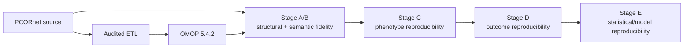

# PCORnet to OMOP validation

This repository contains an audited PCORnet-to-OMOP ETL and a staged validation study asking whether a study remains scientifically reproducible after transformation to OMOP CDM v5.4.2.

The main question is:

> **When a PCORnet-defined study is traced through a frozen OMOP transformation, which source-selected episodes survive, which measurements remain reproducible for shared patients, and how do changed populations affect the final estimates?**

## Start here

Collaborators and students should read the numbered documentation in order:

1. [`docs/01_READ_ME_FIRST.md`](docs/01_READ_ME_FIRST.md)
2. [`docs/02_STUDY_DESIGN_AND_DECISIONS.md`](docs/02_STUDY_DESIGN_AND_DECISIONS.md)
3. [`docs/03_RESULTS_THROUGH_STAGE_E.md`](docs/03_RESULTS_THROUGH_STAGE_E.md)
4. [`docs/04_REPRODUCIBILITY_AND_RERUN.md`](docs/04_REPRODUCIBILITY_AND_RERUN.md)
5. [`docs/05_CODE_REVIEW_GUIDE.md`](docs/05_CODE_REVIEW_GUIDE.md)
6. [`docs/06_MANUSCRIPT_AND_REVIEW_GUIDE.md`](docs/06_MANUSCRIPT_AND_REVIEW_GUIDE.md)
7. [`docs/07_PUBLICATION_FIGURES.md`](docs/07_PUBLICATION_FIGURES.md)
8. [`docs/08_POSTFREEZE_STANDARD_QC_AND_INTERPRETABILITY.md`](docs/08_POSTFREEZE_STANDARD_QC_AND_INTERPRETABILITY.md) (merged post-freeze QC record)
9. [`docs/09_QC_CLOSEOUT_AND_MANUSCRIPT_FINALIZATION.md`](docs/09_QC_CLOSEOUT_AND_MANUSCRIPT_FINALIZATION.md) (QC evidence and manuscript release gates)

Older development notes, lock records, and superseded manuscript fragments are retained under `docs/archive/` for provenance but are not required reading.

## Study layers



## Current status

- Canonical branch: `main`
- Frozen publication ETL commit: `887e6f4d60a6b185e58b3c9fe8887472b49777e3`
- Stages A–E: complete for routine publication work
- Publication figures: one canonical Python module using versioned aggregate inputs
- Publication tables: one code-generated main/supplementary table pipeline
- Generated `results/`: intentionally gitignored
- Patient-level outputs and credentials: must not be committed
- Post-freeze QC and interpretability code merged into `main` through PR #18. The frozen clinical ETL and original Stage A-E estimands remain unchanged.
- Achilles 1.7.2 completed. The corrected DQD 2.9.1 run completed without SQL errors: 1,440 passed, 47 failed and 897 not applicable out of 2,384 checks (96.8% of applicable checks passed). This is target-side quality characterization, not source-to-target study concordance. See [document 12](docs/12_POSTFREEZE_DQD_FINDINGS_AND_OBSERVATION_PERIOD_TYPE.md).
- Current author-shared Word working drafts (not tracked here): main manuscript v1.6.13 and supplement v0.8.10, sent for coauthor review. JAMIA formatting, institutional disclosure approval and final author sign-off remain separate gates.

The key empirical finding is that fixed-cohort representation fidelity was high, but the source-anchored D0 comparison retained 6,001 of 9,815 source patients (38.9% source-only loss) because diagnosis-date eligibility acted before downstream outcome measurement. The primary OMOP cohort was traced from source-selected index episodes, not constructed independently as an OMOP-native phenotype.

## Installation

```bash
python -m venv .venv
source .venv/bin/activate
python -m pip install --upgrade pip
python -m pip install -e '.[etl,analysis,figures,dev]'
```

Create a local configuration from the tracked example and keep secrets out of Git:

```bash
cp config/etl.example.yaml config/etl.yaml
export OMOP_SQL_PASSWORD='your-password'
```

## Rebuild all publication assets

For a clean reproducibility check of all current figures and tables, run:

```bash
bash scripts/rebuild_publication_assets.sh
```

This removes obsolete local `jamia*` output directories from earlier development iterations, validates the frozen aggregate input, generates all eight current figures, and regenerates all current main/supplementary tables into one canonical location:

- `results/publication_assets/figures/`
- `results/publication_assets/tables/`

## Generate publication figures only

```bash
pcornet-omop-figures
```

The figure command writes a reproducibility manifest containing the aggregate-input hash, Git SHA, software version, font, and output hashes. See [`docs/07_PUBLICATION_FIGURES.md`](docs/07_PUBLICATION_FIGURES.md).

To validate the frozen figure input without rendering:

```bash
pcornet-omop-figures --verify-only
```

## Generate publication tables only

```bash
pcornet-omop-tables
```

## Code orientation

- ETL implementation: `src/pcornet_omop_validation/etl/`
- Study analyses: `src/pcornet_omop_validation/study/`
- Locked scientific definitions: `study_definitions/`
- Current publication aggregate input: `study_definitions/artifacts/publication_figure_data_v2.json` (original frozen v1 retained for provenance)
- Canonical publication figure code: `src/pcornet_omop_validation/study/publication_figures.py`, with aggregate-only Figure 2/S2/S4 builders in `publication_figure_paper2026.py`
- Canonical publication table code: `src/pcornet_omop_validation/study/publication_tables.py`
- One-command publication rebuild: `scripts/rebuild_publication_assets.sh`
- Current documentation: `docs/01_...` through `docs/12_...`, with dated post-freeze records in 08–12
- Historical provenance: `docs/archive/`

Each ETL/study code directory also contains a README explaining scientific conventions and how to review the modules.

## Data governance

This repository is public. Do not commit source parquet files, Athena vocabulary packages, database credentials, patient identifiers, row-level predictions, or other row-level sensitive outputs. Aggregate outputs must be disclosure-reviewed before being added to documentation.
