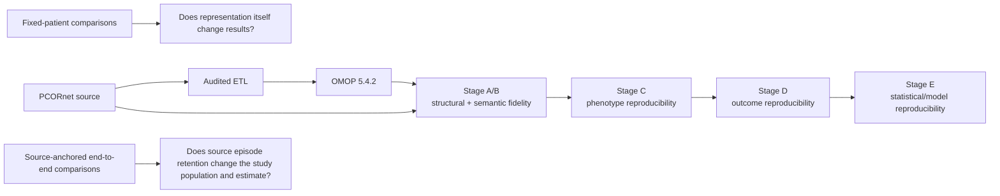

# 01 — Read this first

This repository evaluates whether a study implemented in PCORnet remains scientifically reproducible after transformation to OMOP CDM v5.4.2.

The central question is not simply whether rows were copied correctly. It is:

> **When a PCORnet-defined study is traced through the frozen OMOP transformation, do source-selected episodes survive, and do the shared-patient analyses reproduce the same variables, outcomes and estimates?**

**Post-freeze DQD outcome (2026-11-01):** The corrected restricted DQD 2.9.1 assessment completed with 1,440 passed, 47 failed, 897 not applicable and no SQL errors. See [document 12](12_POSTFREEZE_DQD_FINDINGS_AND_OBSERVATION_PERIOD_TYPE.md) for the confirmed observation-period type vocabulary issue, documented domain gaps and the future-version review plan. This assessment did not modify frozen clinical data.

## Recommended reading order

Read the seven core study documents in order. For the separate post-freeze extension, read documents 08 and 09 after document 07:

1. **`01_READ_ME_FIRST.md`** — orientation, study question, and repository map.
2. **`02_STUDY_DESIGN_AND_DECISIONS.md`** — what was tested, why each validation layer exists, and which scientific decisions were frozen.
3. **`03_RESULTS_THROUGH_STAGE_E.md`** — consolidated quantitative results from Stages A–E.
4. **`04_REPRODUCIBILITY_AND_RERUN.md`** — how the ETL/analyses were frozen, what may be rerun, and what outputs are intentionally not committed.
5. **`05_CODE_REVIEW_GUIDE.md`** — how to read the ETL and study code, including the files where scientific choices are implemented.
6. **`06_MANUSCRIPT_AND_REVIEW_GUIDE.md`** — current manuscript framing, reviewer questions, limitations, and what feedback is most useful.
7. **`07_PUBLICATION_FIGURES.md`** — reproducible publication figures, Nature-oriented artwork standards, and figure-generation commands.
8. **`08_POSTFREEZE_STANDARD_QC_AND_INTERPRETABILITY.md`** — dated post-freeze Achilles/DQD and interpretability development record, now merged into `main`.
9. **`09_QC_CLOSEOUT_AND_MANUSCRIPT_FINALIZATION.md`** — verified QC evidence, unresolved limitations, and manuscript completion gates.

Historical development notes, interim lock records, and superseded manuscript fragments are retained under `docs/archive/`. They are provenance, not required reading.

## Study at a glance

## The key result

When the **same patients, index dates, and follow-up** were compared, mapped clinical information and downstream analyses were preserved extremely well: fixed-index 30/90-day acute-care outcomes were exact, conventional logistic-regression associations were nearly identical, and logistic predicted probabilities correlated at approximately 0.999994.

However, the source-anchored comparison traced PCORnet-selected stroke episodes through ETL lineage. It found 9,815 source D0 patients and 6,001 lineage-retained OMOP patients (3,814 source-only, 38.9%). This was not an independent OMOP-native cohort construction. The main eligibility interaction was that the PCORnet stroke phenotype could use encounter-date fallback when `DX_DATE` was missing, while the frozen ETL required a recorded diagnosis date. Different calendar periods and observability also limit interpretation of the end-to-end outcome contrast.

A post-freeze harmonized sensitivity imposed the same nonmissing-`DX_DATE` requirement on both sides. Under that symmetric eligibility rule, D0, D1, and D3 phenotype membership and index dates were reproduced exactly.

The scientific lesson is therefore:

> **Technical transformation fidelity does not automatically guarantee end-to-end study reproducibility. Cohort eligibility and selection must be validated explicitly because selective upstream loss can propagate into outcome estimates, covariate distributions, effect estimates, and prediction models.**

## What collaborators should review

Please focus feedback on:

- whether the fixed-cohort versus end-to-end distinction is scientifically clear;
- whether any ETL policy should be described differently from an ETL defect;
- whether the causal explanation for cohort divergence is adequately supported;
- whether the manuscript overstates generalizability beyond this dataset, ETL, phenotype, and outcome;
- whether the main/Extended Data figure split communicates the result without redundancy;
- whether additional analyses are truly necessary or would create unnecessary post-hoc scope.

## Canonical technical anchors

- Canonical branch: `main`
- Frozen publication ETL commit: `887e6f4d60a6b185e58b3c9fe8887472b49777e3`
- OMOP target: CDM v5.4.2
- Current `main` includes completed Stages A–E and the post-freeze QC/interpretability code merged through PR #18. The latest author-shared Word drafts remain outside the public repository.
- Generated `results/` and rendered `figures/generated/` are intentionally gitignored; committed documentation and figure-data artifacts contain disclosure-reviewed aggregate summaries rather than patient-level outputs.
