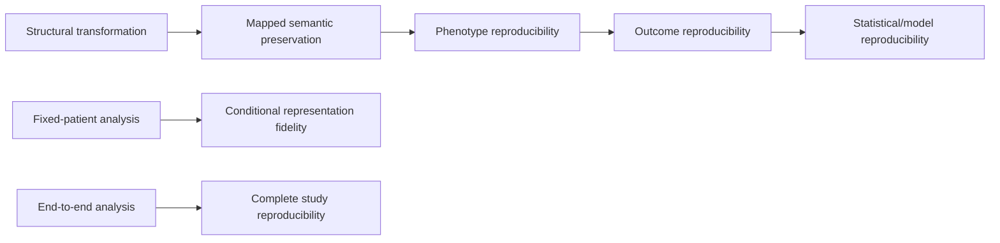

# 06 — Manuscript and review guide

This document tells collaborators what the current paper is arguing and where critical review is most useful.

## Working scientific question

> **When a source-selected PCORnet study is traced through a frozen OMOP transformation, which parts remain reproducible for the same patients, and how does selective retention change the final estimates?**

## Proposed conceptual contribution

The manuscript should emphasize that common-data-model validation is layered:

The key methodological point is that conditional fidelity and end-to-end reproducibility are not interchangeable.

## Main empirical story

1. The audited ETL produced explainable structural differences rather than unexplained row loss.
2. Mapped patient-level clinical semantics were preserved essentially exactly.
3. The original source-faithful ischemic-stroke phenotypes had substantially smaller OMOP cohorts because the source phenotype could use encounter-date fallback for diagnoses lacking `DX_DATE`, while the frozen ETL explicitly required `DX_DATE`.
4. When nonmissing diagnosis-date eligibility was imposed symmetrically, D0/D1/D3 phenotype membership and index dates were exactly reproduced.
5. When the same patients and index dates were held fixed, 30/90-day acute-care outcomes were exactly reproduced.
6. Source-anchored end-to-end 30/90-day risks differed because the lineage-retained OMOP population was smaller than the source-defined population. The comparison was not an independent OMOP-native cohort construction.
7. On the same fixed cohort, baseline features, logistic associations, and conventional logistic predictions were nearly identical.
8. Source-anchored end-to-end model performance differed because the training/evaluation populations differed. The calendar-era structure of missing diagnosis dates limits causal interpretation of these population contrasts.

## Strongest defensible conclusion

> **An audited PCORnet-to-OMOP conversion can preserve mapped clinical information and conditional analyses extremely well while an explicit upstream eligibility policy still changes cohort membership and propagates into end-to-end risks and model performance.**

## Claims to avoid

Do not write:

- “OMOP and PCORnet are equivalent.”
- “OMOP caused worse prediction.”
- “All cohort loss was an ETL error.”
- “The harmonized Stage C sensitivity replaces the original Stage C analysis.”
- “The original recurrent endpoint required recurrent `PDX=P`.”
- “The study proves general equivalence for other sites, phenotypes, outcomes, or ETL implementations.”
- “The primary OMOP cohort was built independently of PCORnet source-selected index episodes.”
- “The 24.8% versus 29.6% source-only/shared 90-day risk contrast establishes a causal effect of the ETL rather than a descriptive association across different admission periods.”

## What we want reviewers to challenge

Collaborators should actively challenge:

### Study-design clarity

- Is the fixed-cohort versus end-to-end distinction obvious?
- Are primary, sensitivity, and post-outcome analyses clearly labeled?
- Is the harmonized Stage C sensitivity framed as answering a fairness/causal-attribution question rather than erasing the original practical portability result?

### Causal interpretation

- Does the evidence support the stated mechanism for cohort divergence?
- Are we careful not to call deliberate ETL policy effects implementation defects?
- Are alternative explanations appropriately ruled out only where data support that conclusion?

### Clinical/statistical importance

- Do we explain why selective cohort loss can matter more than a small overall row-loss percentage?
- Do we explain that transformation problems can affect prevalence, treatment-effect estimates, confounding distributions, subgroup composition, time-to-event analyses, and prediction models?
- Are we clear that the seriousness of a transformation difference depends on which patients/events are lost, not only how many?

### Generalizability

- Is the single-site/single-dataset scope stated clearly?
- Are vocabulary limitations and the missing PROVIDER source table appropriately acknowledged?
- Do we avoid extrapolating the exact stroke result to unrelated phenotypes?

## Practical recommendations the paper can make

A researcher validating a CDM transformation should:

1. compare explicit eligibility rules between source and target implementations;
2. report source/target/intersection/source-only/target-only cohort counts;
3. compare index dates;
4. characterize **who is lost**, not only how many rows are lost;
5. compare important covariate distributions and missingness;
6. compare outcomes patient-by-patient among shared patients;
7. run both fixed-cohort and end-to-end analyses;
8. compare final estimands, confidence intervals, and model performance;
9. decompose discrepancies into ETL defect, ETL policy, CDM representation, vocabulary coverage, or analysis-definition causes;
10. preserve enough lineage to make that decomposition possible.

## Current manuscript source

**Current coauthor handoff (2026-11-19):** The latest author-shared working drafts available to this review are main manuscript **v1.6.13** and supplementary material **v0.8.10**. The files were sent to Qiran for introduction/literature revision and are not tracked in this public GitHub repository. The separate source-anchored comparison, DQD summary and limitations in those Word files supersede the earlier v1.3 figure-placement example and v1.6.2 handoff discussions. These versions are not the final submitted manuscripts.

- The primary D0 comparison is **source-anchored**: 9,815 PCORnet source-selected episodes, of which 6,001 retained the selected diagnosis/episode through OMOP lineage. The 3,814 source-only patients represent 38.9% loss, not a de novo cross-CDM phenotype discrepancy.
- For shared patients and index dates, 90-day outcomes were exact (1,132 events among 3,822 eligible in both representations). End-to-end risk and prediction contrasts combine population retention and representation-specific observability. Do not interpret the 24.8% source-only versus 29.6% shared outcome risk as an adjusted comparison. The groups span different calendar periods.
- The diagnosis-date missingness pattern varied strongly by admission era. We identified the temporal pattern and a transformation-date policy consequence, **not** the upstream source-system cause. Incomplete pre-index lookback can also affect records early in 2010.
- The post-freeze OHDSI DQD 2.9.1 run **completed**: 1,440 checks passed, 47 failed, 897 not applicable, zero SQL errors. The 96.8% applicable-check pass rate does not establish complete OMOP coverage or absence of selective source-event loss. Target-only DQD checks cannot directly count source records excluded before materialization. Some failed visit-concept and observation-period checks have unassessed relevance to the stroke analysis. See [document 12](12_POSTFREEZE_DQD_FINDINGS_AND_OBSERVATION_PERIOD_TYPE.md).
- DQD, Achilles and post-freeze interpretability code were merged into `main` through PR #18. Clinical ETL code and original Stages A-E estimands remain frozen at their publication versions.

For collaborator revisions, work from the author-shared Word file, preserve granular tracked changes and live Zotero fields, and keep the code-generated publication figures. Do not re-create the manuscript from archived fragments. Complete institutional aggregate-disclosure clearance, coauthor approval, ethics metadata and target-journal formatting before public submission.
